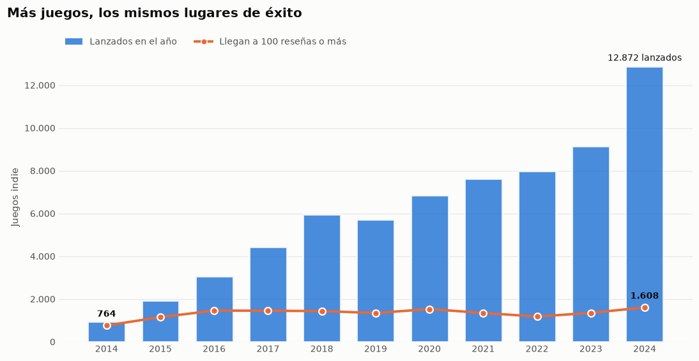
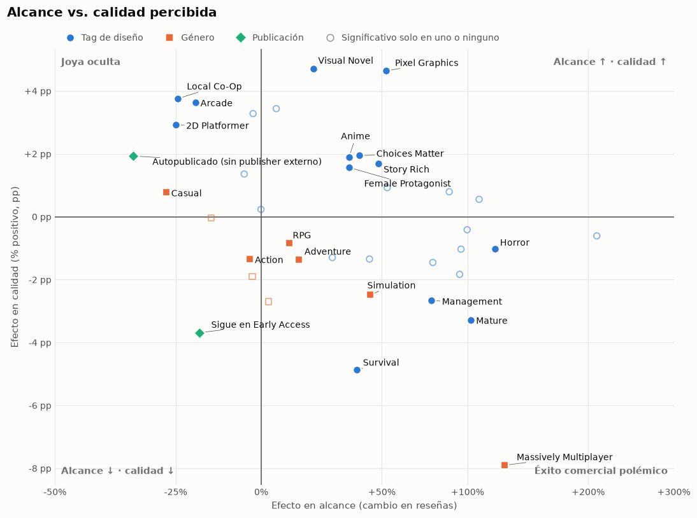

# ¿Qué hace que un indie destaque en Steam?

Análisis del mercado de videojuegos indie en Steam: tendencias de lanzamiento,
saturación, géneros, etiquetas, precios y los factores que se asocian con el
**alcance comercial** y con la **calidad percibida** de un juego.

> Análisis completo (snapshot del 13-11-2026). Dashboard en Streamlit en desarrollo.

## Preguntas de investigación

1. ¿Cómo han evolucionado el volumen de lanzamientos indie y la saturación del mercado?
2. ¿Qué etiquetas y géneros se asocian con más reseñas y cuáles con mejor valoración?
3. ¿Qué relación hay entre el precio y el éxito? ¿Existe un rango de precio óptimo?
4. ¿Influyen el mes y el día de lanzamiento, tener demo o salir de Early Access?
5. ¿Qué tan concentrado está el éxito entre los juegos más populares?

## Enfoque

El éxito se mide en **dos dimensiones separadas**: volumen de reseñas (alcance, un
proxy de ventas) y porcentaje de reseñas positivas (calidad percibida, en juegos con
50 o más reseñas). Cruzarlas da cuatro perfiles: *alcance y calidad altos*, *éxito
comercial polémico*, *joya oculta* y *alcance y calidad bajos*.

Universo: indies publicados en Steam (sin software), con foco en las cohortes
2016–2023. Los resultados son **asociaciones, no relaciones causales**.
Detalles en [`docs/decisiones_metodologicas.md`](docs/decisiones_metodologicas.md).

## Hallazgos principales

### 1. Más juegos, los mismos lugares de éxito



Entre 2016 y 2024 los lanzamientos indie se multiplicaron por **4,2**, pero la cantidad
de juegos que llegan a 100 reseñas se mantuvo en **~1.200–1.600 por año**. La
probabilidad de llegar bajó del **47,5 % al 12,5 %**, y el **1 %** de los indies
concentra el **75 %** de todas las reseñas.

### 2. Alcance y calidad responden a factores casi opuestos



- **Éxito comercial polémico:** juegos sistémicos y de larga duración (Massively
  Multiplayer, Survival, Management, Simulation, Mature) atraen mucho público, pero se
  valoran peor.
- **Joya oculta:** juegos compactos y precisos (2D Platformer, Arcade, Local Co-Op,
  Casual) y los autopublicados se valoran mejor, pero llegan a menos jugadores.
- **Alcance y calidad a la vez:** juegos narrativos y de estilo definido (Visual Novel,
  Story Rich, Choices Matter, Pixel Graphics, Anime, Female Protagonist).

### 3. Precio y momento de lanzamiento (modelos con controles)

- **Precio:** frente a $5–9,99, los indies de $20–29,99 tienen ~6 veces más reseñas. A
  partir de $5 la valoración no cambia; por debajo de $2 cae en ambas dimensiones.
- **Día:** el jueves es el mejor día; sábado (−25 %) y domingo (−21 %) rinden peor
  aunque se controle si el juego tiene publisher.
- **Mes:** enero es el mejor mes; noviembre y diciembre, ~30 % menos. Una prueba de
  robustez con cohortes antiguas confirma que es estacionalidad, no antigüedad.
- **Publisher:** los autopublicados tienen 35 % menos reseñas, pero +1,9 pp de valoración.

Análisis completo en [`notebooks/01_regresion.ipynb`](notebooks/01_regresion.ipynb).

**Límites:** las reseñas son un proxy de ventas; precio, DLC e idiomas reflejan el
estado actual de la tienda, no el del lanzamiento; la etiqueta "indie" es
autodeclarada; el dataset no incluye demos, así que esa parte de la pregunta 4 queda
pendiente.

## Stack

| Capa | Herramienta |
|---|---|
| Extracción | Python (ijson, requests), Steam Store API, SteamSpy |
| Almacenamiento y modelado | PostgreSQL: staging en JSONB y modelo estrella |
| Análisis | SQL (CTEs, funciones de ventana), pandas, statsmodels, scipy |
| Visualización | matplotlib (notebooks), Streamlit + Plotly (dashboard) |

## Modelo de datos

```
staging.games_raw (JSONB por juego y snapshot)
        │
        ▼
core.dim_game ── bridge_game_tag ── dim_tag
     │       ├── bridge_game_genre ── dim_genre
     │       ├── bridge_game_category ── dim_category
     │       ├── bridge_game_developer ── dim_developer
     │       └── bridge_game_publisher ── dim_publisher
     │
     ├── dim_date (fecha de lanzamiento)
     └── fact_game_snapshot (precio, reseñas, propietarios, CCU, tiempo de juego)
```

Cada carga se guarda como un *snapshot* fechado, de modo que los datos de Kaggle y
las actualizaciones de la API conviven y permiten ver la evolución en el tiempo.

## Estructura

```
├── app/            # Dashboard en Streamlit
├── data/           # raw/ y processed/ (no se versionan)
├── docs/           # Decisiones metodológicas e imágenes del README (img/)
├── notebooks/      # Exploración y modelos
├── sql/            # Esquema, transformaciones, EDA (eda/) y dataset de modelos (analysis/)
├── src/etl/        # Carga y orquestación del pipeline
├── src/analysis/   # Dataset de modelado, regresiones y gráficos
└── tests/fixtures/ # Datos de muestra para probar el pipeline
```

## Cómo reproducirlo

```bash
# 1. Entorno
python -m venv .venv
source .venv/bin/activate          # Windows: .venv\Scripts\activate
pip install -r requirements.txt

# 2. Base de datos
createdb steam_indie
cp .env.example .env               # y completa tus credenciales

# 3. Datos: descarga games.json del dataset de FronkonGames en data/raw/

# 4. Pipeline (usa como snapshot la fecha de actualización del dataset)
python -m src.etl.pipeline --json data/raw/games.json --snapshot-date AAAA-MM-DD
```

### Análisis

- **Exploración en SQL:** `sql/eda/01` a `05`, una consulta a la vez (en pgAdmin, selecciónala y pulsa F5).
- **Regresión:** abre `notebooks/01_regresion.ipynb` en VS Code con el kernel del `.venv`.
  Las figuras se hacen con matplotlib (imágenes estáticas que GitHub muestra);
  el dashboard usa Plotly para las gráficas interactivas.
- **Figuras del README:** `python -m src.analysis.readme_figures` las regenera en `docs/img/`.

### Pruebas sin el dataset real

Usa una base de datos aparte para no mezclar datos de prueba con los reales:

```bash
createdb steam_indie_test
# Casos especiales de formato
PGDATABASE=steam_indie_test python -m src.etl.pipeline --json tests/fixtures/sample_games.json --snapshot-date 2026-01-15
# 6.000 juegos sintéticos con efectos conocidos, para validar los modelos
python tests/generate_synthetic_games.py data/raw/synthetic.json --n 6000
PGDATABASE=steam_indie_test python -m src.etl.pipeline --json data/raw/synthetic.json --snapshot-date 2026-11-13
```

## Datos

- [Steam Games Dataset](https://www.kaggle.com/datasets/fronkongames/steam-games-dataset),
  de Fronkon Games, construido con la API de Steam y SteamSpy.
- Steam Store API y SteamSpy para el enriquecimiento.

## Hoja de ruta

- [x] Estructura del repo y modelo de datos
- [x] Carga del dataset base y transformación a modelo estrella
- [x] Análisis exploratorio en SQL
- [x] Modelos de regresión (alcance y calidad)
- [x] Hallazgos y conclusiones
- [ ] Dashboard en Streamlit
- [ ] Enriquecimiento con Steam API y SteamSpy (demos y nuevos snapshots)
